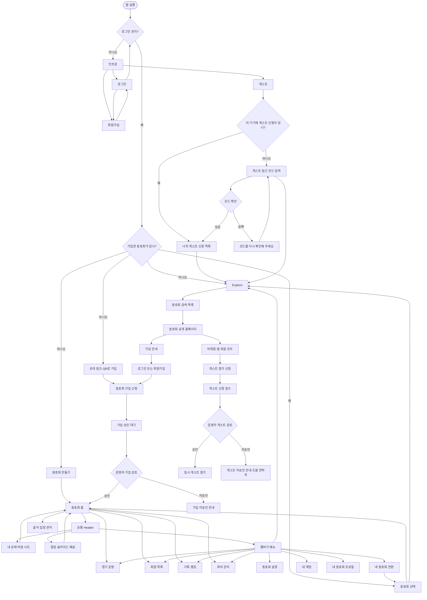
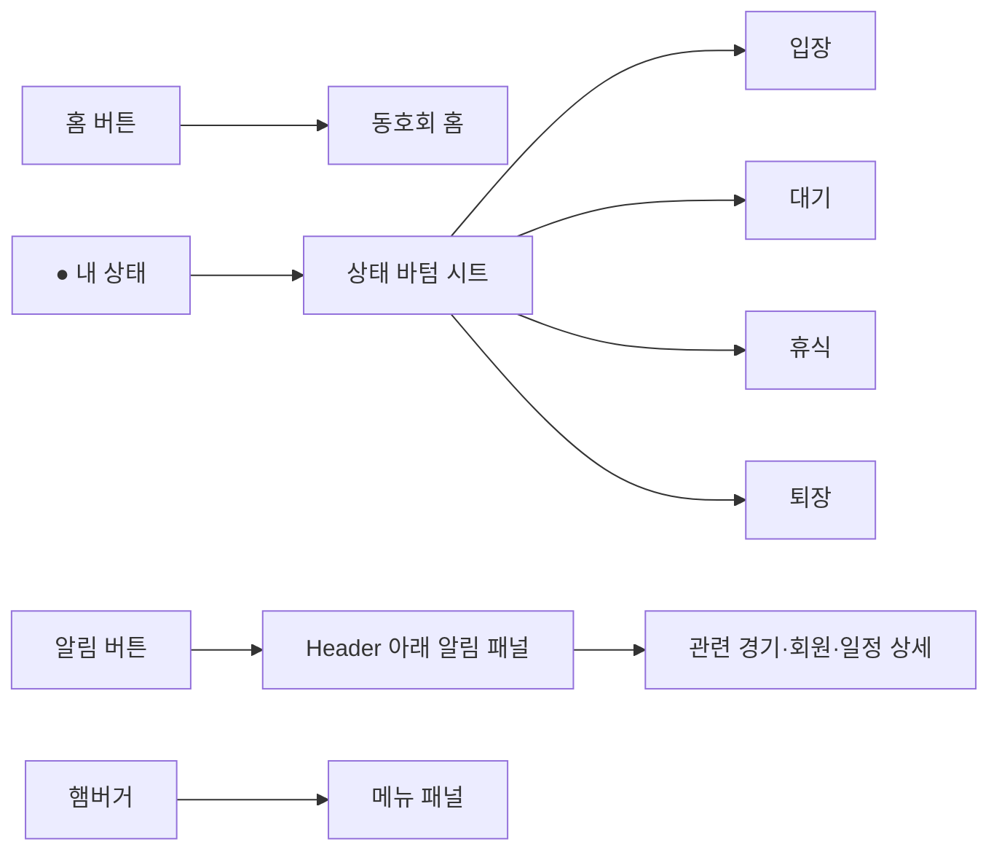
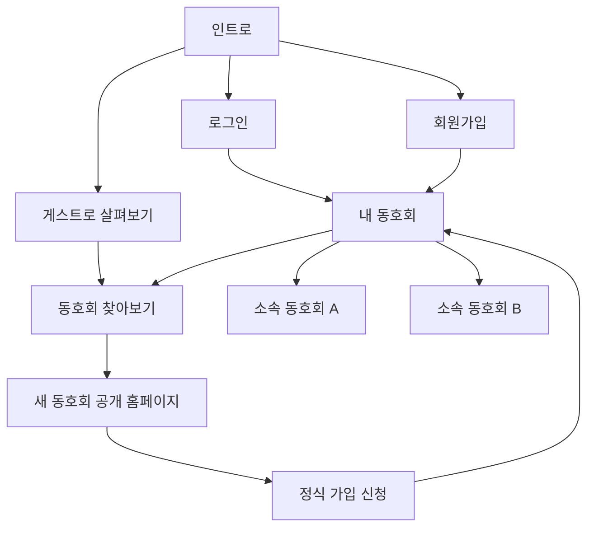
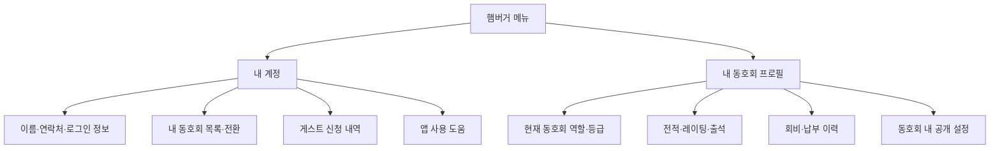
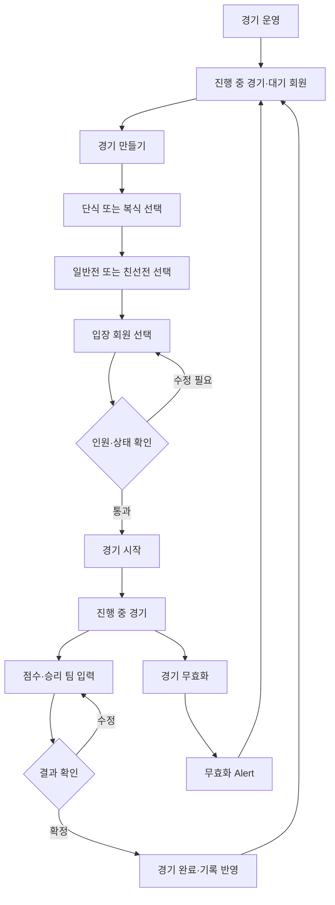
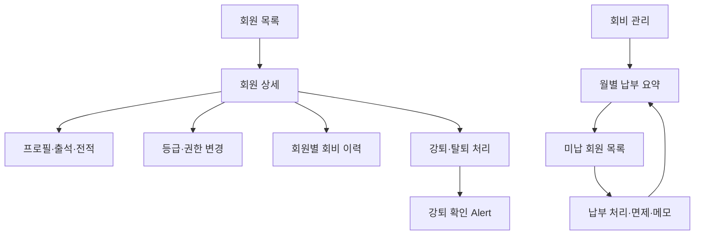
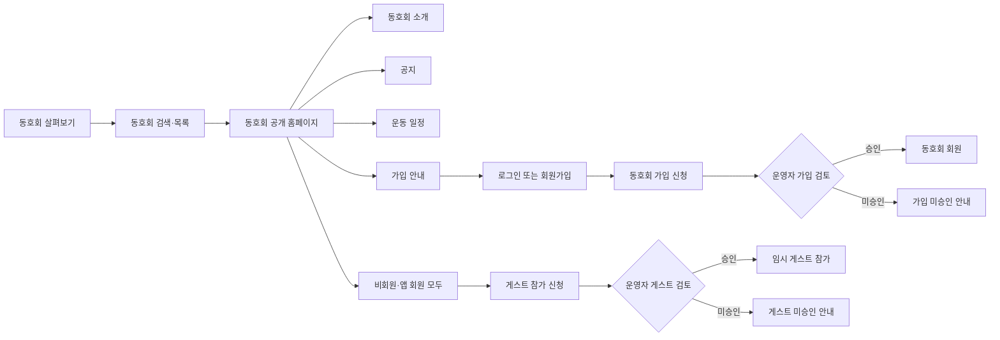
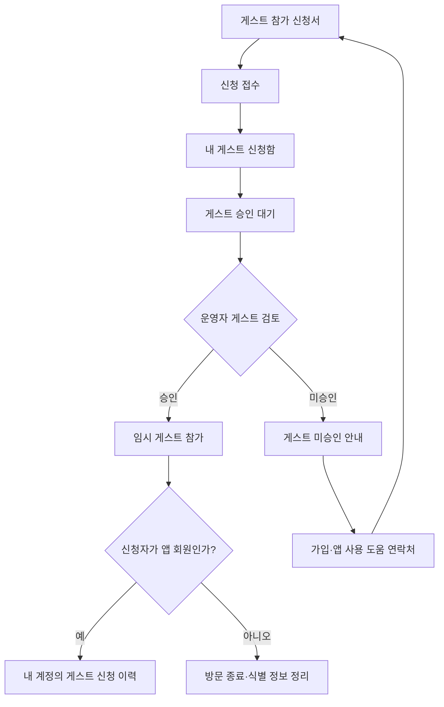
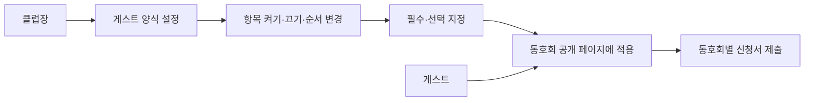

# UI 화면 흐름

> [!info] 설계 범위
> 첫 번째 흐름도는 로그인부터 동호회 운영의 핵심 행동까지를 다룬다. 화면의 세부 구성은 각 화면 노트에서 이어서 정한다.

## 전체 흐름

## Header의 공통 흐름

## 인트로와 다중 동호회 소속

- 인트로의 `게스트`는 곧 `게스트로 살펴보기`다. 로그인 없이 공개 동호회를 검색하고 둘러볼 수 있다.
- 앱 회원은 여러 동호회에 동시 소속될 수 있다. 동호회마다 권한, 등급, 레이팅, 회비 상태가 독립적이다.
- 로그인한 회원도 `내 동호회 선택`과 햄버거 메뉴의 `동호회 찾아보기`를 통해 언제든 새 동호회를 살펴볼 수 있다.
- 새 동호회에 정식으로 가입하려면 앱 회원 상태에서 `동호회 가입 신청 → 승인`을 거친다.
- 현재 선택한 동호회는 앱의 운영 문맥이다. 출석·경기·알림·회원 목록은 항상 그 동호회 기준으로 표시한다.

## 내 계정과 내 동호회 프로필

| 화면 | 보여 주는 정보 | 기준 |
| --- | --- | --- |
| `내 계정` | 이름, 연락처, 로그인·보안, 내 동호회 목록, 게스트 신청 내역, 앱 도움 | 앱 회원 전역 정보 |
| `내 동호회 프로필` | 현재 동호회 역할·등급, 레이팅·전적, 출석, 회비, 동호회 내 공개 설정 | 현재 선택한 동호회 정보 |

- `내 계정`은 동호회를 전환해도 바뀌지 않는다.
- `내 동호회 프로필`은 동호회를 바꿀 때마다 완전히 달라진다. 동호회 A의 레이팅·회비·권한이 동호회 B에 보이면 안 된다.
- 동호회에 가입하지 않은 비회원·게스트에게는 `내 동호회 프로필`을 보여 주지 않는다. 대신 게스트 신청 상태와 도움 연락처를 보여 준다.

## 경기 운영 흐름

## 회원·회비 운영 흐름

## 동호회 살펴보기와 공개 홈페이지 흐름

### 사용자·동호회·게스트의 구분

| 구분 | 의미 | 동호회 소속 | 데이터 성격 |
| --- | --- | --- | --- |
| 비회원 | 앱 계정이 없는 방문자 | 없음 | 공개 페이지 열람만 가능 |
| 앱 회원 | 앱 회원가입을 마친 사용자 | 동호회마다 별도 가입 상태를 가질 수 있음 | 지속 데이터 |
| 동호회 회원 | 앱 회원이 특정 동호회 가입을 승인받은 상태 | 있음 | 앱 회원과 동호회 사이의 별도 관계 데이터 |
| 게스트 | 비회원 또는 앱 회원이 특정 운동·방문에 임시 참가 신청한 상태 | 없음 | 계정 연결 여부에 따라 임시 또는 이력 데이터 |

- 앱 회원(`User`)과 동호회(`Club`)는 완전히 별개다.
- 동호회 회원은 `User`와 `Club`을 연결하는 별도 가입 관계다. 한 앱 회원은 여러 동호회에 가입할 수 있다.
- 게스트 신청은 비회원·앱 회원 모두 할 수 있고, 앱 회원가입이나 동호회 회원 가입을 만들지 않는다. 승인되어도 임시 참가 상태만 부여된다.
- 앱 회원의 게스트 신청은 본인 계정에 연결해 이력으로 남긴다. 비회원 게스트의 식별 정보는 만료·정리 정책에 따라 삭제 또는 익명화한다.

### 게스트 공개 범위

비회원 게스트도 `동호회 살펴보기`에서 공개 동호회 목록을 검색하고, 각 동호회의 소개·공지·일정·가입 안내를 볼 수 있다.

- 비회원과 앱 회원 모두 동호회를 살펴본 뒤 같은 `게스트 참가 신청`을 남길 수 있다. 이 신청은 정식 동호회 가입과 별개다.
- 로그인한 앱 회원이 게스트 신청을 하면 본인 기본 정보를 미리 채울 수 있지만, 신청 과정과 승인 기준은 비회원 게스트와 동일하다.
- 회원 목록, 출석 현황, 경기 상세, 회비, 내부 알림은 로그인·가입 이후에만 접근할 수 있다.
- 비공개 동호회는 검색 목록에 노출하지 않고 초대 링크·QR로만 진입하게 한다.
- 동호회가 공개할 정보의 범위는 운영자가 설정한다. 초기 버전은 소개·공지·일정만 공개한다.

### 게스트 참가 신청과 승인 결과

- 신청서에는 이름, 연락 가능한 수단, 방문 희망 일정, 간단한 참가 사유만 받는다. 불필요한 개인정보는 최초 신청에 요구하지 않는다.
- 게스트 신청은 로그인 여부와 무관하게 동일한 동호회별 양식을 사용한다. 로그인한 신청자에게만 계정 연결 정보를 내부적으로 보관할 수 있다.
- 신청자는 `게스트 승인 대기` 상태를 확인할 수 있고, 승인 또는 미승인 결과를 안내받는다.
- 인트로의 `게스트`는 별도 `나의 게스트 신청 목록` 페이지로 연결한다. 로그인·회원가입과 동등한 최상위 진입점이다.
- 같은 브라우저·앱에 게스트 신청 기록이 있으면 목록을 바로 보여 준다. 기록이 없으면 빈 목록 대신 `게스트 접근 코드 입력`을 먼저 보여 준다.
- 접근 코드를 확인한 뒤에는 해당 신청을 현재 기기의 `나의 게스트 신청 목록`에 추가한다. 목록에서 `동호회 찾아보기`로 이동해 새 게스트 신청도 할 수 있다.
- 비회원 게스트에게는 계정 페이지 대신 `나의 게스트 신청 목록`을 제공한다. 같은 브라우저·앱에서는 신청한 동호회와 승인 상태를 다시 확인할 수 있다.
- 비회원 신청함은 서버 원본을 대체하지 않는다. 추측 불가능한 신청 접근 권한으로 서버 상태를 조회하며, 신청 내용·연락처는 목록에 저장하지 않는다.
- 승인되어도 동호회 회원이 되지 않는다. 비회원은 앱 회원도 되지 않으며, 해당 운동 또는 방문에만 유효한 임시 게스트 상태가 된다.
- 미승인 안내에는 사유를 선택적으로 표시하고, 재신청 가능 여부와 도움 연락처를 함께 둔다.

### 게스트 신청 데이터 보존

| 신청자 | 내 계정 기록 | 연락처·양식 답변 | 방문 종료 후 처리 |
| --- | --- | --- | --- |
| 비회원 게스트 | 없음 | 운동 종료 후 7일간 임시 보관 | 7일 뒤 삭제 또는 익명화 |
| 앱 회원 게스트 | `내 계정 > 게스트 신청 내역`에 남김 | 필요한 범위만 보관 | 신청·승인·참가 이력은 유지, 민감 항목은 별도 정리 정책 적용 |

- 앱 회원의 이력에는 동호회명, 신청·승인 상태, 방문 예정일 또는 참가일 정도를 기본으로 남긴다.
- 전화번호, 전달 메모, 동호회가 추가로 받은 답변은 이력 화면에 무기한 그대로 노출하지 않는다. 개인정보 항목별 보관 기간을 별도로 둔다.
- 앱 회원이 계정을 삭제하면, 본인의 게스트 신청 이력도 삭제 또는 익명화 대상이 된다.
- 비회원은 신청이 동호회 게스트 신청 DB에 등록된 직후 발행된 `게스트 접근 코드`를 복사해 보관한다. 기기 저장이 사라진 뒤에는 이 코드로만 본인 신청 상태를 다시 조회한다.

### 동호회별 게스트 신청 양식

게스트 신청 양식은 각 동호회 클럽장이 설정한다. 동호회마다 체험 참가 기준과 필요한 정보가 다르므로, 하나의 고정 양식을 강제하지 않는다.

| 기본 제공 항목 | 입력 방식 | 클럽장 설정 |
| --- | --- | --- |
| 이름 | 한 줄 입력 | 사용 / 필수 여부 |
| 전화번호 | 전화번호 입력 | 사용 / 필수 여부 |
| 나이 또는 출생연도 | 숫자 또는 선택 | 사용 / 필수 여부 |
| 급수 | 선택 또는 한 줄 입력 | 사용 / 필수 여부, 선택지 설정 |
| 배드민턴 경력 | 선택 또는 한 줄 입력 | 사용 / 필수 여부 |
| 성별 | 선택 | 사용 / 필수 여부 |
| 방문 희망 일정 | 날짜·세션 선택 | 사용 / 필수 여부 |
| 전달 메모 | 여러 줄 입력 | 사용 / 필수 여부 |

- 클럽장은 항목을 켜고 끄며, 보여주는 순서와 `필수/선택` 여부를 정한다.
- 초기는 위의 표준 항목으로 시작한다. 완전히 자유로운 질문·답변 제작 기능은 운영 수요를 확인한 뒤 추가한다.
- 모든 신청서에는 동호회가 설정한 개인정보 수집 안내와 동의 체크를 표시한다.
- 전화번호 같은 연락처는 해당 동호회의 클럽장·매니저에게만 보이고, 게스트 참가 데이터 만료 정책에 따라 함께 정리한다.
- 필수 항목은 label에 `* 필수`를 명확히 쓰고, 입력 오류는 Alert가 아니라 해당 Input 아래에 표시한다.
- 개인정보 수집 안내, 운영자 준수 서약, 신청자 책임 문구의 자세한 기준은 [[04 개인정보 및 게스트 양식 정책]]을 따른다.

### 가입·앱 사용 도움 연락처

앱 사용이 익숙하지 않은 게스트를 위해, 공개 홈페이지와 신청 결과 화면에 `가입·앱 사용 도움` 연락처를 항상 노출한다. `비상 연락처`보다 목적이 명확한 이름을 사용한다.

| 위치 | 노출 내용 | 목적 |
| --- | --- | --- |
| 공개 홈페이지 가입 안내 하단 | 전화, 카카오톡 채널 또는 이메일 중 운영자가 지정한 수단 | 가입 전 문의 |
| 승인 대기·미승인 화면 | 같은 도움 연락처와 운영 시간 | 신청 상태·앱 사용 문의 |
| 앱 햄버거 메뉴 하단 | 서비스 도움·문의 | 로그인 후 사용 도움 |

- 동호회 운영자의 개인 전화번호를 기본 공개값으로 두지 않는다. 공개에 동의한 연락 수단 또는 공식 문의 채널만 표시한다.
- 전화 버튼은 `전화하기`, 카카오톡은 `문의하기`처럼 행동을 텍스트로 명확히 쓴다.
- 도움 연락처는 가입 신청·상태 확인 화면에서 로그인 없이 접근할 수 있어야 한다.

## 다음 세분화 순서

- [ ] [[동호회 홈]]: 첫 화면의 정보 우선순위와 카드 배치
- [ ] [[회원 목록]]: 회원 카드·필터·상세 화면 흐름
- [ ] [[경기 운영]]: 매칭 생성·진행·결과 입력 화면 흐름
- [ ] [[회비 관리]]: 월별 정산과 미납 처리 흐름
- [ ] [[햄버거 메뉴]]: 메뉴 항목과 권한별 노출 규칙

관련: [[00 프로젝트 홈]] · [[01 디자인 시스템]] · [[MVP 기능 목록]]
