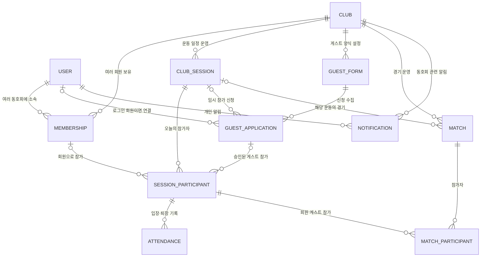

# 데이터 설계 원칙

> [!summary] 지금 정할 것과 나중에 정할 것
> 지금은 엔터티의 관계·소유권·생명주기만 정한다. 실제 SQL 컬럼, 인덱스, API 요청 형태는 해당 기능을 구현할 때 확정한다.

## 지금 확정할 핵심 관계



## 엔터티별 역할

| 엔터티 | 지금 확정하는 역할 | 나중에 세부 설계할 것 |
| --- | --- | --- |
| `User` | 앱 회원 계정과 전역 프로필 | 이름 공개 범위, 연결 소셜 계정 |
| `Club` | 독립된 동호회 단위 | 소개 페이지·테마·공개 설정 |
| `Membership` | User와 Club의 가입 관계 | 역할, 등급, 레이팅, 회비 상태 |
| `ClubSession` | 특정 날짜·시간의 운동 모임 | 장소, 코트 수, 참가 신청 규칙 |
| `SessionParticipant` | 특정 운동에 실제로 참가하는 회원·승인 게스트 | 회원 참가인지 게스트 참가인지, 임시 상태 |
| `Attendance` | 참가자의 세션별 입장·퇴장 기록 | 자동 퇴장, 당일 레이팅 스냅샷 |
| `GuestForm` | 클럽장이 설정한 게스트 양식 | 필수 항목, 항목 순서, 보관 기간 |
| `GuestApplication` | 게스트의 임시 참가 신청 | 승인 상태, 양식 답변, 데이터 정리 시점 |
| `Match` | 동호회 세션에서의 경기 | 점수, 경기 모드, 결과, 무효화 |
| `MatchParticipant` | 경기와 회원·게스트의 참가 관계 | 팀, 레이팅 변화, 승패 |
| `Notification` | 개인·동호회 알림 | 중요도, 읽음 상태, 관련 화면 링크 |

## 바꾸면 안 되는 데이터 원칙

- `User`에 동호회 등급·레이팅·회비를 직접 저장하지 않는다. 이것들은 `Membership` 소속이다.
- 모든 내부 운영 데이터는 `Club` 또는 `ClubSession` 문맥을 가진다.
- 게스트 신청은 `Membership`을 만들지 않는다. 앱 회원 게스트면 `User`에 연결할 수 있지만, 동호회 회원은 아니다.
- 승인된 게스트가 경기에 참여할 수 있도록, 경기 참가자는 `Membership`이 아니라 해당 운동의 `SessionParticipant`를 기준으로 연결한다.
- 경기 결과는 숫자를 덮어쓰기보다 결과·참가자·레이팅 변동 이력을 남길 수 있게 설계한다.
- 게스트는 `Membership`이 없으므로 레이팅도 없다. 게스트의 `MatchParticipant.rating`은 항상 `null`이며 레이팅 이력을 만들지 않는다.
- 복식 팀에 게스트와 회원이 함께 있으면 팀 레이팅은 회원의 레이팅으로 계산하고, 회원의 ELO만 평소처럼 변동시킨다.
- 게스트가 단식에 참가했을 때 상대 회원의 ELO를 반영할지는 **미정**이다.
- 경기는 결과를 확정할 때만 레이팅을 반영한다. `playing` 상태에서만 무효화할 수 있으므로, 무효화된 경기는 레이팅 변동·원복 모두 없다.
- 개인정보가 있는 게스트 양식 답변은 일반 운영 기록과 분리해 보관·정리 정책을 적용한다.

## 동시 요청 처리 원칙

정원, 소속 슬롯, 경기 참가 상태처럼 여러 요청이 같은 값을 **읽고 → 판단하고 → 저장**하는 기능은 트랜잭션 경계만으로 충분하지 않다. 같은 기준 행을 `SELECT ... FOR UPDATE`로 잠근 뒤, 잠금 안에서 최신 값을 확인하고 저장한다.

| 기능 | 잠글 대상 | 막는 문제 |
| --- | --- | --- |
| 레슨 신청 | 해당 `lesson_sessions` 행 | 동시 신청으로 레슨 횟수 정원 초과 |
| 동호회 가입 신청 | 해당 `users` 행 | 소속 슬롯 5개 초과 |
| 경기 만들기 | 배정할 `session_participants` 행들 | 같은 회원이 두 경기에 동시 배정 |
| 입장하기 | 해당 `session_participant` 또는 세션·회원 기준 행 | 중복 입장 기록 |

- 레슨 신청은 `lesson_sessions` 행을 잠근 뒤 활성(`pending`·`approved`) 신청의 `quantity` 합계와 `capacity`를 비교한다.
- 잠금은 위처럼 공유된 수량·상태를 판단하는 기능에만 쓴다. 공지 작성, 이름 수정, 읽음 처리, 정산 입금 한 줄 추가처럼 단순 추가·수정에는 필요 없다.
- 백엔드 구현 시 이 표를 기준으로 잠금 범위와 순서를 통일한다.

## 구현 직전에 결정할 것

- 정확한 PostgreSQL 테이블과 컬럼 타입
- `JSONB`로 둘 게스트 양식 정의·답변 구조
- 인덱스와 조회 최적화
- ELO 계산식과 게스트 단식 참가 시 상대 회원 ELO 반영 여부
- API 경로·요청·응답 타입
- 개인정보 항목별 보관 기간과 삭제 배치 작업

## 작업 순서

```text
동호회 홈 UI
→ 화면에 필요한 목업 데이터 확정
→ 해당 화면의 API 계약 정의
→ PostgreSQL 테이블·마이그레이션 작성
→ Express 기능 구현
```

관련: [[00 프로젝트 홈]] · [[02 UI 화면 흐름]] · [[06 인프라 및 데이터베이스 결정안]] · [[07 동호회 홈 화면 설계]] · [[09 JSON 데이터 모델]]
