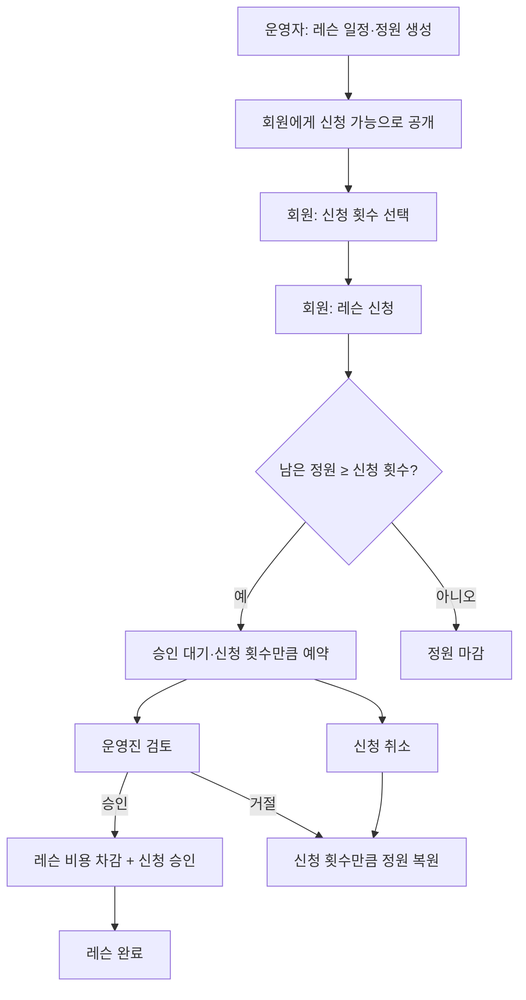

# 동호회 1:1 레슨 기능 설계

> [!summary] 기능 정의
> 동호회가 코치·날짜·운영 시간·그날 제공할 레슨 횟수 정원을 열면 회원이 1:1 레슨을 신청한다. 실제 레슨 순서와 개별 시간은 동호회 내부 소통으로 정하고, 서비스는 신청 **횟수**와 정산 장부만 관리한다. 운영진이 신청을 승인하면 해당 회원의 **동호회 정산 잔액**에 레슨 횟수만큼 비용을 차감한다.

## 핵심 원칙

- 레슨은 경기·출석과 별개의 예약 기능이다. 당일 체육관 입장 여부가 레슨 신청의 선행 조건은 아니다.
- 레슨은 회원 한 명에게 진행하는 1:1 수업이지만, 서비스에서 회원별 시간 순서를 배정하지 않는다. 실제 수업 순서는 동호회 내부 소통으로 정한다.
- 레슨 일정의 `capacity`는 그날 진행할 **레슨 횟수 정원**이다. 운영진이 레슨 날마다 직접 정한다.
- 회원은 같은 일정에 여러 회를 신청하거나 신청을 여러 번 남길 수 있다. 중복 신청을 막는 제약은 두지 않는다.
- `pending`과 `approved` 신청의 `quantity` 합계가 정원을 차지한다. 거절·취소되면 해당 `quantity`만큼 자리가 다시 열린다.
- 운영진이 이미 신청된 횟수보다 정원을 낮춰도 시스템은 막거나 기존 신청을 자동 취소하지 않는다. 누가 몇 회를 포기하거나 거절할지는 운영진이 직접 정리한다.
- 코치는 동호회 회원일 수도 있고, 앱 계정이 없는 외부 초빙 강사일 수도 있다.
- 외부 코치는 이름만 등록해도 된다. 앱 로그인, 회원 프로필, 동호회 가입 관계를 강제하지 않는다.
- 비용은 PG 결제나 자동 계좌이체를 처리하지 않는다. 회원이 동호회에 입금하면 운영자가 확인 후 정산 잔액을 수동으로 올린다.
- 정산 잔액은 회비·레슨비·환불·정정을 함께 기록한다. 양수는 선납·적립 잔액, 음수는 회원이 동호회에 낼 **미수금**이다.
- 정산 잔액은 앱 전체 잔액이 아니라 **동호회별 회원 잔액**이다. 동호회 A의 회비·레슨비는 동호회 B와 섞이지 않는다.
- 회비는 회원별·등급별 자동 산정하지 않는다. 1년치 선납, 여러 달치 납부, 면제 등 실제 동호회 상황에 맞춰 운영진이 회원·금액을 직접 입력해 수동 청구한다.
- 입금 내역을 자동 조회하지 않는다. 운영진이 실제 입금을 확인한 뒤 `입금 처리` 행을 직접 추가한다.
- 레슨 신청의 승인·거절은 코치 여부와 관계없이 운영진만 할 수 있다.
- 회원이 남기는 레슨 요청 메모는 초기 버전에 두지 않는다. 수업 내용은 코치와 회원이 별도로 조율한다.

## 흐름



## 데이터 구조

### 코치

```jsonc
{
  // 동호회 안에서 레슨을 진행하는 사람
  "clubCoach": {
    "id": "coach_kim",
    "clubId": "club_hanbit",
    "displayName": "김코치",

    // 회원 코치면 연결, 외부 초빙 강사면 null
    "linkedMembershipId": null,

    // 화면·권한 판단용 구분. 이름 표시에는 두 경우 모두 displayName을 사용한다.
    "type": "external", // member | external
    "status": "active"
  }
}
```

### 레슨 일정·신청

```jsonc
{
  // 운영자가 한 번에 여는 레슨 일정. 실제 회원별 수업 순서는 내부 소통으로 정한다.
  "lessonSession": {
    "id": "lesson_session_01",
    "clubId": "club_hanbit",
    "coachId": "coach_kim",
    "lessonDate": "2026-11-22",
    "startsAt": "2026-11-22T18:00:00+09:00",
    "endsAt": "2026-11-22T21:00:00+09:00",
    "capacity": 8, // 그날 진행할 레슨 횟수 정원
    "pricePerPerson": 20000, // 레슨 1회 비용
    "approvalMode": "manual", // 운영진 수동 승인만 사용
    "applicationDeadlineAt": "2026-11-22T17:00:00+09:00",
    "status": "open" // open / closed / completed. full은 저장하지 않고 조회 때 계산
  },

  // 회원의 레슨 신청. 신청 당시 비용을 별도 보관해 이후 가격 변경의 영향을 받지 않는다.
  // 같은 회원이 같은 일정에 여러 신청을 남길 수 있다.
  // pending 또는 approved 신청은 quantity만큼 이 일정의 정원을 차지한다.
  "lessonApplication": {
    "id": "lesson_application_01",
    "lessonSessionId": "lesson_session_01",
    "applicantMembershipId": "membership_hong",
    "quantity": 3, // 신청한 레슨 횟수. 1 이상의 정수
    "status": "pending", // pending | approved | rejected | cancelled | completed | no_show
    "priceSnapshot": 20000,
    "creditStatus": "not_charged", // not_charged | charged | refunded
    "reviewedByMembershipId": null,
    "reviewedAt": null
  }
}
```

### 정원·동시 요청 제약

동시에 신청 버튼을 눌러도 정원을 초과해 신청되면 안 된다. 화면에서 남은 횟수를 보여주는 것만으로는 막을 수 없으므로, 신청 처리 시 `lesson_sessions` 행을 `SELECT ... FOR UPDATE`로 잠근다. 잠금 안에서 활성(`pending`·`approved`) 신청의 `quantity` 합계와 `lessonSession.capacity`를 함께 확인한 뒤 저장한다.

- `pending` 신청도 `quantity`만큼 정원을 예약한다. 승인 여부를 기다리는 동안 다른 회원이 그 횟수를 가져가지 못하게 한다.
- 거절(`rejected`), 취소(`cancelled`)되면 해당 신청의 `quantity`는 정원 계산에서 제외된다.
- 남은 정원은 `capacity - 활성 신청의 quantity 합계`로 계산한다. 같은 회원의 여러 신청도 모두 합산한다.
- `full`은 저장하지 않고, 남은 정원이 0 이하인지 조회할 때 계산한다. 저장해야 할 사정이 생기면 신청·취소·거절과 같은 트랜잭션 안에서 함께 갱신해 자리가 나면 다시 `open`이 되게 한다.
- 운영진이 정원을 현재 활성 신청 `quantity` 합계보다 낮춘 경우 기존 신청은 유지한다. 남은 정원이 음수면 `정원 초과 · 운영진 조정 필요`로 보여 주고, 운영진이 신청을 거절하거나 수량을 줄여 정리한다.

### 동호회 정산 잔액: 회비·레슨비 통합

정산 잔액은 단순한 숫자 하나를 수정하지 않고, 변동 사유가 남는 원장(ledger)으로 관리한다. 회비와 레슨비 모두 같은 원장에 기록하므로, 운영자는 회원별로 입금·회비 청구·레슨 차감·환불·정정 이력을 한곳에서 볼 수 있다.

```jsonc
{
  // 특정 동호회 안에서만 유효한 회원 정산 계정
  "clubSettlementAccount": {
    "clubId": "club_hanbit",
    "membershipId": "membership_hong",
    // 양수: 선납·적립 잔액 / 음수: 동호회에 낼 미수금
    "balance": -20000
  },

  // 회비·레슨비 변동 기록. 금액은 증가면 양수, 차감·청구면 음수.
  "clubSettlementLedger": {
    "id": "credit_ledger_01",
    "clubId": "club_hanbit",
    "membershipId": "membership_hong",
    "amount": 50000,
    "type": "manual_deposit", // manual_deposit | dues_charge | lesson_charge | lesson_refund | adjustment
    "description": "11월 회비 입금 확인",
    "relatedLessonApplicationId": null,
    "createdByMembershipId": "manager_lee",
    "createdAt": "2026-11-10T10:30:00+09:00"
  }
}
```

### 정산 처리 규칙

| 시점 | 레슨 일정 정원 | 정산 처리 |
| --- | --- | --- |
| 회원 신청 | `pending`, 신청 `quantity`만큼 예약 | 금액 변동 없음. 회원은 잔액이 음수여도 신청할 수 있다. |
| 운영진 승인 | `approved`, 신청 `quantity`만큼 유지 | `priceSnapshot × quantity`를 실제 차감하고 `lesson_charge` 원장 기록 생성. 잔액은 음수가 될 수 있다. |
| 거절·승인 전 취소 | 신청 `quantity`만큼 복원 | 금액 변동 없음. |
| 승인 뒤 취소 | 신청 `quantity`만큼 복원 | 동호회 취소 규정에 따라 환불 또는 미환불. 환불하면 `lesson_refund` 원장 기록 생성. |
| 운영자 회비·레슨비 입금 확인 | 변경 없음 | `manual_deposit` 원장 기록과 함께 잔액을 증가. |
| 운영자 회비 청구 | 변경 없음 | `dues_charge` 원장 기록으로 잔액을 감소. 미납이면 음수 미수금으로 남는다. |

> [!info] 회비 청구 방식
> 회비는 매월 자동 생성하지 않는다. 운영진이 대상 회원과 금액을 직접 고르는 수동 청구만 제공한다. 따라서 1년치 할인 납부나 여러 달치 입금도, 실제 확인 금액만큼 `입금 처리`를 추가하면 자연스럽게 반영된다.

> [!warning] 잔액 표현
> 화면에서 양수는 `적립 잔액 30,000원`, 0원은 `정산 완료`, 음수는 `미수금 20,000원`으로 명확히 표시한다. `-20,000원` 숫자만 보여 주지 않는다.

## UI 항목

### 레슨 신청 카드

#### Design

- 넓은 연령대가 빠르게 읽도록, 달력 중심 화면보다 `날짜 → 코치 → 운영 시간 → 남은 횟수 정원` 순서로 시작한다.
- 색만으로 상태를 구분하지 않는다. 날짜, 운영 시간, 남은 횟수 정원, 상태 문구, 1회 비용을 함께 표시한다.
- 실제 레슨 순서와 타인의 신청 정보·이름은 노출하지 않는다. 회원에게는 `신청 가능`, `내 승인 대기`, `정원 마감`만 보인다.

```text
11월 22일 토요일 · 김코치
18:00 ~ 21:00 · 정원 8회 중 3회 신청
[ 횟수 선택 ]  [ 레슨 신청 ]  1회 20,000원

내 신청 상태: 승인 대기 3회 · 승인 시 60,000원 차감
정원 마감: 신청 가능한 레슨 횟수가 모두 찼어요.
```

#### CSS

- 횟수 선택과 신청 버튼은 모두 40px 이상의 높이, `border-strong` 1px, `radius-md` 8px을 적용한다.
- 신청 버튼은 한 번 누르면 응답 전까지 바로 비활성화해 같은 신청이 중복 제출되지 않게 한다. 서버의 행 잠금 검사는 별도로 반드시 유지한다.
- 내 신청이 있는 카드는 `blue-50` 배경 + `blue-600` 테두리 + 굵은 상태명으로 구분한다.
- 정원 마감 카드는 회색 배경만 쓰지 않고 `정원 마감` 텍스트와 `8회 중 8회 신청`을 함께 둔다.
- 공통 `.btn`로 억지로 묶지 않는다. 실제 같은 일정 카드 조합이 세 번 이상 반복될 때 `LessonApplicationCard` 컴포넌트로 만든다.

#### 적용

- 회원: `레슨 신청` 화면, `나의 다음 레슨` 카드, `나의 신청 내역`.
- 운영진: 레슨 일정별 신청 목록과 승인·거절 처리 화면.
- 확인: 작은 모바일 폭에서도 날짜·운영 시간·남은 횟수 정원·상태·비용이 읽히고, 승인 대기·정원 마감 상태를 색 없이도 구분할 수 있어야 한다.

### 동호회 정산 요약 카드

#### Design

```text
동호회 정산
미수금 20,000원
이번 레슨 · 승인 시 20,000원 차감
[ 정산 내역 보기 ]
```

- 실제 금액은 `tabular-nums`로 표시한다.
- 양수 잔액은 `적립 잔액`, 음수 잔액은 `미수금`으로 이름을 바꿔 표시한다.
- 잔액이 음수여도 레슨 신청·승인을 막지 않는다. 필요한 제한은 동호회가 나중에 정책으로 정할 수 있다.
- 운영자만 `입금 처리`, `회비 청구`, `정정` 행동을 볼 수 있다.

#### CSS

- 기본 `.card`와 Text 토큰 조합을 사용한다. 금액 전용 카드 변형 클래스는 만들지 않는다.
- 정산 행은 색상뿐 아니라 `+ 입금 처리`, `- 회비 청구`, `- 레슨 차감`, `+ 환불` 텍스트를 함께 표시한다.

#### 적용

- 회원: 레슨 화면 상단과 `내 동호회 프로필`의 회비·정산 영역.
- 운영자: 회원 상세의 정산 내역, 수동 입금 처리, 회비 청구 폼.
- 확인: 회비 청구·입금 처리·레슨 승인·환불 뒤 회원에게 보이는 잔액과 원장 합계가 항상 같아야 한다.

## 권한

| 행동 | 일반 회원 | 코치 | 운영자·클럽장 |
| --- | --- | --- | --- |
| 레슨 일정 열람·신청 | 가능 | 가능 | 가능 |
| 자신의 신청 취소 | 가능 | 가능 | 가능 |
| 레슨 일정 생성·수정 | 불가 | 불가 | 가능 |
| 신청 승인·거절 | 불가 | 불가 | 모든 레슨 가능 |
| 입금 처리·회비 청구·정정 | 불가 | 불가 | 가능 |
| 정산 원장 전체 열람 | 본인 것만 | 본인 것만 | 해당 동호회 회원 전체 |

## 보류할 정책

- 승인된 레슨을 회원이 취소할 수 있는 마감 시간
- 승인 뒤 취소 시 전액 환불·부분 환불·미환불 기준
- 한 회원이 한 주 또는 한 달에 예약할 수 있는 최대 횟수
- 외부 코치가 직접 앱에 접속해 승인할 필요가 생길 때의 초대·권한 방식

관련: [[02 UI 화면 흐름]] · [[12 유저 데이터 설계]] · [[01 디자인 시스템]] · [[15 CSS 기반 규칙]]
